# Security Homelab

Segmented virtual enterprise lab for practicing attack, detection, and hardening. Built in VMware Workstation as a self-directed project.

**Status:** In progress (started November 24, 2026)

## Goals
- Build a segmented network with a firewall separating attacker, internal, and DMZ zones
- Run common attacks from Kali against machines I built myself
- Detect them in Wazuh and write custom rules mapped to MITRE ATT&CK
- Harden the systems and measure the difference by rerunning the attacks

## Architecture

| Zone | Network | Machines |
|------|---------|----------|
| Attacker | [subnet] | Kali Linux |
| Internal | [subnet] | Ubuntu Server 24.04, Wazuh |
| DMZ | [subnet] | [web server] |

The three lab zones are isolated VMware networks. Only the OPNsense WAN connects out, through VMware NAT.

## Tools
VMware Workstation, OPNsense, Ubuntu Server 24.04, Kali Linux, Wazuh, Nmap, Hydra

## Results

**Segmentation tests:** firewall rules were tested from Kali and ubuntu-srv, and all six tests passed. See [docs/segmentation-tests.md](docs/segmentation-tests.md).

**Attack and detection results** (in progress):

| Attack | Technique (MITRE ATT&CK) | Detected before hardening? | Detected after? |
|--------|--------------------------|----------------------------|-----------------|
| Nmap scan | [T1046] | [ ] | [ ] |
| SSH brute force | [T1110] | [ ] | [ ] |
| [add more] | | | |

**Summary:** [One or two sentences with your real numbers once you have them.]

## Repo layout
- `docs/` build notes, one file per step
- `detections/` custom Wazuh rules
- `attacks/` what I ran and what the logs showed
- `configs/` sanitized configs only

## Challenges and lessons learned
Ubuntu got no DHCP lease on the Internal segment. Cause: Dnsmasq's interface list excluded INTERNAL. Fix: added it and created a reservation.

## Safety
This lab is isolated and only attacks machines I built. No credentials, keys, or real IPs are committed to this repo.
