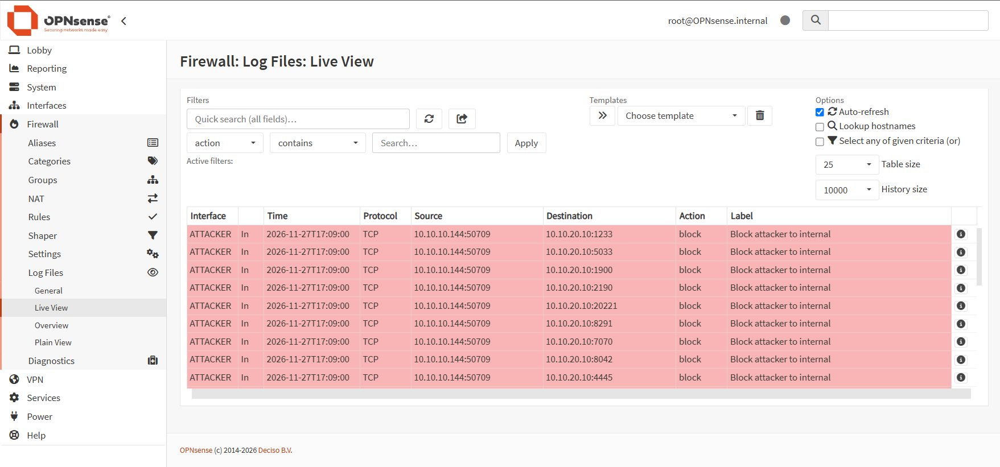
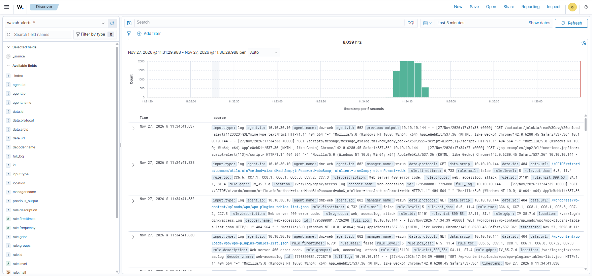
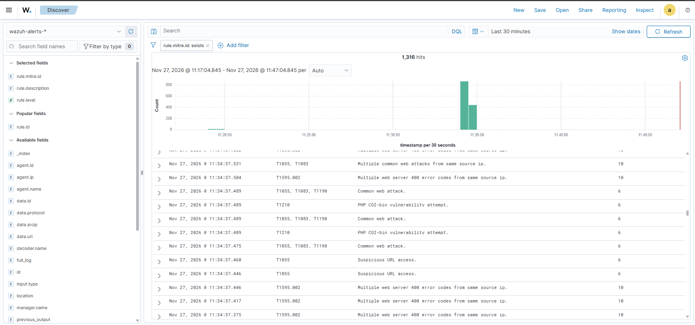
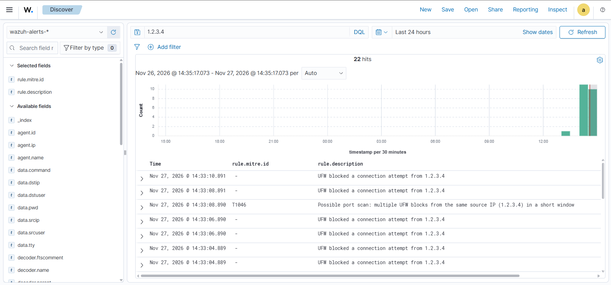

# Attack and Detection Tests

Tested from Kali (Attacker, 10.10.10.144) against ubuntu-srv and dmz-web, 
with Wazuh monitoring both as agents.

## Test 1: Nmap scan against ubuntu-srv

**Command:** `sudo nmap -sV -A 10.10.20.10`

**Result:** Scan completed, only port 22/tcp (SSH) showed open; all 999 other 
ports reported as filtered (no response).

**Wazuh detection:** 0 alerts generated (searched `agent.name: ubuntu-srv` 
in Discover, 0 hits).

**Finding: Firewall-level prevention vs. host-level detection**

Checking OPNsense's Live View log confirmed why: the "Block attacker to internal" 
rule (written and tested in segmentation-tests.md) blocked every probed port in 
real time, dozens of distinct destination ports all logged as blocked from 
10.10.10.144 to 10.10.20.10. Because the traffic never reached ubuntu-srv, 
neither its local ufw logs nor Wazuh's host-based monitoring saw most of the 
scan, only the one ICMP packet type explicitly allowed through (echo/timestamp 
requests) appeared in ufw's log.

This demonstrates that network-layer segmentation can make host-based detection 
largely redundant for already-blocked traffic, while still leaving a clear audit 
trail at the firewall itself. Wazuh's host-based model (HIDS) relies on logs 
generated on the monitored machine; traffic stopped upstream by the firewall 
never produces those logs.

**Evidence:**



## Test 2: SSH brute force against ubuntu-srv (Hydra)

**Command:** `hydra -l internal -P /tmp/passlist.txt ssh://10.10.20.10`

**Result:** 5 login attempts, 0 valid passwords found (custom wordlist used 
intentionally to avoid risk of an accidental successful login).

**Wazuh detection:** 10 alerts generated (one per failed attempt), rule 
description `sshd: authentication failed` (rule ID 5760, rule level 5).

**MITRE ATT&CK mapping (automatic, built-in Wazuh rule):**
- T1110.001 — Password Guessing
- T1021.004 — Remote Services: SSH
- Tactics: Credential Access, Lateral Movement

Unlike the Nmap scan, SSH brute force traffic is allowed through the firewall 
(by design, since ubuntu-srv's only exposed service to the Attacker zone is SSH), 
so it reaches the host and generates real auth.log entries. Wazuh's default 
`sshd` decoder and rule set detected every failed attempt in real time and 
automatically mapped it to the correct MITRE techniques, no custom rule was 
needed for this detection.

**Evidence:**


## Test 3: Web scan against dmz-web (Nikto)

**Command:** `nikto -h http://10.10.30.10`

**Result:** 8,167 requests made in 20 seconds. Findings included the nginx 
version (1.24.0, outdated vs. current 1.31.3) and 8 missing security headers 
(CSP, HSTS, X-Frame-Options, X-Content-Type-Options, Permissions-Policy, 
Referrer-Policy).

**Wazuh detection:** 8,039 alerts generated. Wazuh parses nginx's access log 
directly (`/var/log/nginx/access.log`) via its built-in web-accesslog decoder, 
no additional configuration was needed.

Checking the `rule.description` breakdown across the scan window revealed at 
least 8 distinct rule types firing, each handling a different category of 
request:

| Rule description | MITRE ID(s) | Level |
|---|---|---|
| Multiple web server 400 error codes from same source ip | T1595.002 | 10 |
| Multiple common web attacks from same source ip | T1055, T1083 | 10 |
| Multiple XSS attempts from same source ip | T1059 | 10 |
| SQL injection attempt | T1190 | 7 |
| Suspicious URL access | T1055 | 6 |
| Common web attack | T1055, T1083, T1190 | 6 |
| XSS (Cross Site Scripting) attempt | T1059.007 | 6 |
| PHP CGI-bin vulnerability attempt | T1210 | 6 |

Filtering specifically for `rule.mitre.id: exists` returned 1,316 of the 8,039 
total alerts (about 16%) carrying explicit MITRE mapping.

**Finding:** Wazuh's default web ruleset distinguishes between isolated, 
low-signal events and correlated attack patterns. A single 400 error 
(rule 31101, level 5) carries no MITRE tag on its own, since it could be 
caused by something as mundane as a typo'd URL. Once Wazuh correlates 
repeated 400s from the same source IP, or detects a specific malicious 
payload pattern (XSS, SQL injection, PHP CGI exploitation attempts), the 
resulting alert is escalated to level 6-10 and automatically tagged with 
the appropriate MITRE technique (T1595.002, T1059.007, T1190, T1210, etc.), 
all without any custom rule configuration.

**Evidence:**





## Test 4: Custom rule for Nmap/port-scan detection (addressing the Test 1 gap)

Test 1 showed that OPNsense blocks Nmap scans before they reach ubuntu-srv, so 
Wazuh's host-based monitoring saw nothing. To close this gap, a custom decoder 
and rule were built to parse ubuntu-srv's local `ufw` firewall log and detect 
scan-like patterns.

### Setup

1. **Enabled local firewall logging** on ubuntu-srv:
   ```
   sudo ufw allow ssh
   sudo ufw logging on
   sudo ufw enable
   ```

2. **Configured the Wazuh agent** (`/var/ossec/etc/ossec.conf`) to monitor the new log:
   ```xml
   <localfile>
     <log_format>syslog</log_format>
     <location>/var/log/ufw.log</location>
   </localfile>
   ```

3. **Wrote a custom decoder** (`/var/ossec/etc/decoders/local_decoder.xml`) to parse UFW's kernel-log format and extract source/destination IPs:
   ```xml
   <decoder name="ufw-block">
     <parent>kernel</parent>
     <prematch>UFW BLOCK</prematch>
     <regex>SRC=(\S+) DST=(\S+)</regex>
     <order>srcip, dstip</order>
   </decoder>
   ```

4. **Wrote two custom rules** (`/var/ossec/etc/rules/local_rules.xml`): a base rule
   flagging any single UFW block, and a correlation rule escalating to a 
   port-scan alert when 8+ blocks arrive from the same source IP within 60 
   seconds:
   ```xml
   <group name="ufw,">
     <rule id="100100" level="5">
       <decoded_as>kernel</decoded_as>
       <description>UFW blocked a connection attempt from $(srcip)</description>
       <group>ufw,firewall_block,</group>
     </rule>

     <rule id="100101" level="10" frequency="8" timeframe="60">
       <if_matched_sid>100100</if_matched_sid>
       <same_source_ip />
       <description>Possible port scan: multiple UFW blocks from the same source IP ($(srcip)) in a short window</description>
       <mitre>
         <id>T1046</id>
       </mitre>
       <group>ufw,firewall_block,recon,</group>
     </rule>
   </group>
   ```

### Result

Injecting 10 blocked-connection log lines from one source IP within 10 seconds 
triggered rule 100100 ten times and rule 100101 once, correctly tagged with 
**T1046 (Network Service Discovery)**.

**Evidence:**



### Debugging notes

Getting this working surfaced a non-obvious Wazuh decoder behavior worth 
recording: a custom decoder targeting `program_name: kernel` does not take 
priority over Wazuh's built-in base `kernel` decoder by default. `wazuh-logtest` 
repeatedly reported the event as decoded by the generic base decoder 
(`name: 'kernel'`) rather than ours, with no indication of a conflict or error.

The fix was to explicitly declare the custom decoder as a **child** of the 
built-in one (`<parent>kernel</parent>`), which lets it run as a continuation 
of the base decoder rather than competing with it. The rule's `<decoded_as>` 
then had to reference `kernel` (the reported top-level decoder name) rather 
than the custom decoder's own name, since Wazuh reports the parent's name in 
the `name` field even when a child decoder successfully extracted fields.

A second, separate issue came from checking in the wrong place: individually 
testing lines with `wazuh-logtest` confirmed the rule logic worked, but the 
real pipeline (agent → manager) initially appeared to produce no alerts at 
all for live traffic. This turned out to be a visibility gap, not a bug: 
Wazuh's `archives.log` (which records every event the manager receives, not 
just alerted ones) was not enabled by default. Turning on `<logall>yes</logall>` 
in the manager's `ossec.conf` confirmed the agent was in fact delivering the 
events correctly all along, and once compared side-by-side the live pipeline 
matched the logtest behavior exactly.

## Summary

| Attack | Target | Technique(s) | Detected by default rules? | Detected after custom rule? |
|---|---|---|---|---|
| Nmap scan (-sV -A) | ubuntu-srv | T1046 (Network Service Discovery) | No — blocked upstream by OPNsense, never reached the host | **Yes** — custom ufw decoder + correlation rule (Test 4) |
| SSH brute force (Hydra) | ubuntu-srv | T1110.001, T1021.004 | Yes — default Wazuh rule, auto-MITRE-tagged | N/A (already detected) |
| Web scan (Nikto) | dmz-web | T1595.002, T1059, T1059.007, T1190, T1210, T1055, T1083 | Yes — default Wazuh rules across 8+ distinct rule types, auto-MITRE-tagged | N/A (already detected) |

Two of the three attacks were caught by Wazuh's default ruleset with no 
configuration needed, demonstrating strong out-of-the-box coverage for 
authentication and web-layer attacks. The one gap (network-level 
reconnaissance against a host whose traffic is already blocked upstream) 
required a custom decoder and correlation rule, built in Test 4, to close. 
That exercise also surfaced a genuine Wazuh quirk (custom decoders needing 
an explicit `<parent>` relationship to take priority over built-in ones for 
the same `program_name`), documented in the Challenges section below.
