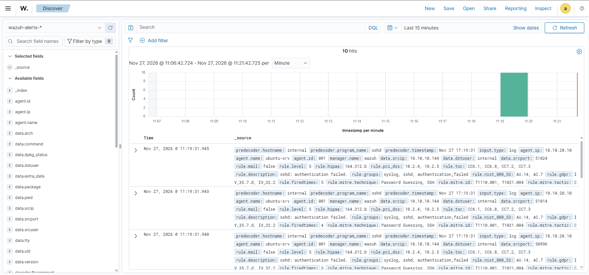
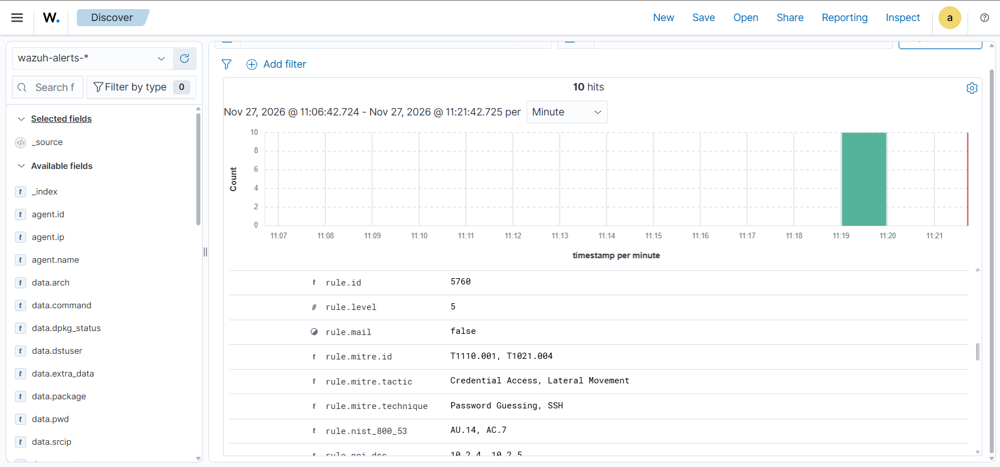

# Attack and Detection Tests

Tested from Kali (Attacker, 10.10.10.144) against ubuntu-srv and dmz-web, 
with Wazuh monitoring both as agents.

## Test 1: Nmap scan against ubuntu-srv

**Command:** `sudo nmap -sV -A 10.10.20.10`

**Result:** Scan completed, only port 22/tcp (SSH) showed open; all 999 other 
ports reported as filtered (no response).

**Wazuh detection:** 0 alerts generated (searched `agent.name: ubuntu-srv` 
in Discover, 0 hits).

**Finding: Firewall-level prevention vs. host-level detection**

Checking OPNsense's Live View log confirmed why: the "Block attacker to internal" 
rule (written and tested in segmentation-tests.md) blocked every probed port in 
real time, dozens of distinct destination ports all logged as blocked from 
10.10.10.144 to 10.10.20.10. Because the traffic never reached ubuntu-srv, 
neither its local ufw logs nor Wazuh's host-based monitoring saw most of the 
scan, only the one ICMP packet type explicitly allowed through (echo/timestamp 
requests) appeared in ufw's log.

This demonstrates that network-layer segmentation can make host-based detection 
largely redundant for already-blocked traffic, while still leaving a clear audit 
trail at the firewall itself. Wazuh's host-based model (HIDS) relies on logs 
generated on the monitored machine; traffic stopped upstream by the firewall 
never produces those logs.

**Evidence:**

## Test 2: SSH brute force against ubuntu-srv (Hydra)

**Command:** `hydra -l internal -P /tmp/passlist.txt ssh://10.10.20.10`

**Result:** 5 login attempts, 0 valid passwords found (custom wordlist used 
intentionally to avoid risk of an accidental successful login).

**Wazuh detection:** 10 alerts generated (one per failed attempt, plus 
related events), rule description `sshd: authentication failed`, rule level 5.

**MITRE ATT&CK mapping (automatic, built-in Wazuh rule):**
- T1110.001 — Password Guessing
- T1021.004 — Remote Services: SSH
- Tactics: Credential Access, Lateral Movement

Unlike the Nmap scan, SSH brute force traffic is allowed through the firewall 
(by design, since ubuntu-srv's only exposed service to the Attacker zone is SSH), 
so it reaches the host and generates real auth.log entries. Wazuh's default 
`sshd` decoder and rule set detected every failed attempt in real time and 
automatically mapped it to the correct MITRE techniques, no custom rule was 
needed for this detection.

**Evidence:**

