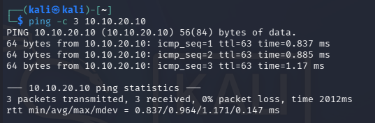
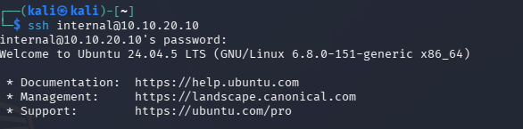
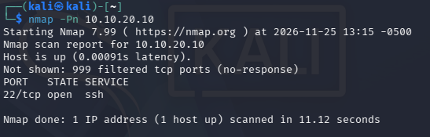
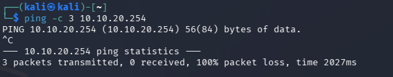

# Segmentation Tests

Tested from Kali (Attacker, 10.10.10.144) after applying firewall rules.

| # | Test | Expected | Result | Evidence |
|---|------|----------|--------|----------|
| 1 | ping 10.10.20.10 (from Kali) | Allowed | Pass (replies received) | kali-ping-allowed.png |
| 2 | ssh to 10.10.20.10 (from Kali) | Allowed | Pass (login succeeded) | kali-ssh-allowed.png |
| 3 | nmap -Pn 10.10.20.10 (from Kali) | Only 22/tcp open | Pass (only 22/tcp open) | kali-nmap-allowed-host.png |
| 4 | ping 10.10.20.254 (from Kali) | Blocked | Pass (no reply) | kali-ping-blocked.png |
| 5 | nmap 10.10.20.254 (from Kali) | Filtered/timeout | Pass (scan timed out) | kali-nmap-blocked-host.png |
| 6 | ping 10.10.10.144 (from ubuntu-srv) | Blocked | Pass (no reply) | ubuntu-ping-attacker-blocked.png |

[paste the summary line here]

## Rules tested
- ATTACKER: allow SSH and ping to 10.10.20.10, block the rest of INTERNAL, allow DMZ
- INTERNAL: block traffic to ATTACKER

## Evidence

### Allowed traffic (Kali to ubuntu-srv)

**Test 1: ping to ubuntu-srv succeeds**

**Test 2: SSH to ubuntu-srv succeeds**

**Test 3: Nmap finds only port 22 open**

### Blocked traffic

**Test 4: ping to the firewall interface gets no reply**

**Test 5: Nmap to the firewall interface times out**

![Nmap scan of 10.10.20.254
